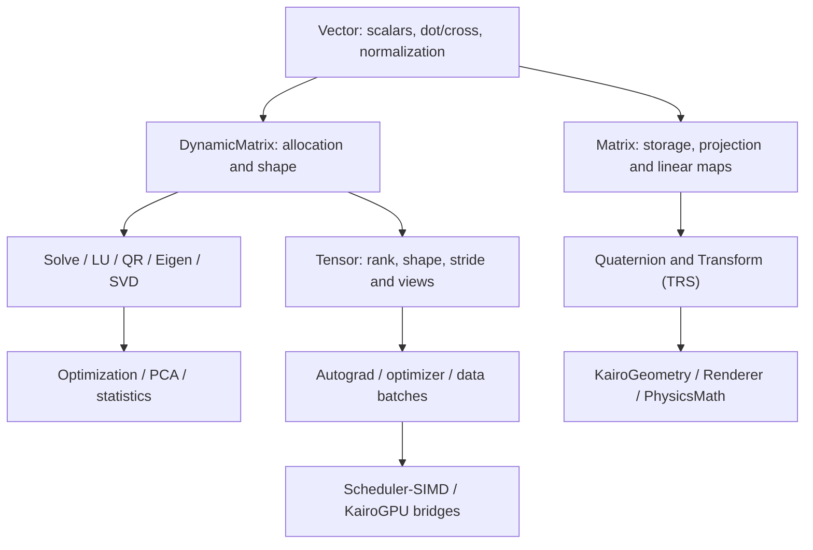

# From vectors to numerical computing — KairoMath

This is the conceptual companion to [the complete linked source map](SOURCE_READING_ORDER.md). Read each implementation and its tests after the explanation. It describes the actual code conventions and supported APIs, not a claim that every algorithm is optimal or verified on every host.

## 1. Why mathematics is an engine API

A renderer, collision detector and physical simulator must agree on what a vector means. If one library treats its matrices as row-vector transforms and another multiplies column vectors, a camera can silently project in the wrong direction. If one expects centimeters and another meters, a force or inertia calculation can be wrong by orders of magnitude.

The vector/matrix foundation owns **numerical representations**. KairoGeometry owns geometric shapes, KairoSpatial owns acceleration structures, KairoPhysicsEngine owns simulation state and contact solving, and KairoRenderer owns native GPU resources.

## 2. Vectors: points, directions, normals and arithmetic

[Vector.cppm](../Vector.cppm) exports Vector2/3/4, arithmetic concepts and free operations such as `Dot`, `Cross`, `SafeNormalize`, `Reflect`, `Refract`, `Project` and `Lerp`.

The dot product `a·b = |a||b|cos(theta)` measures alignment. The right-handed cross product gives a perpendicular vector whose direction depends on operand order: `cross(a,b) = -cross(b,a)`. A triangle normal, torque `r cross F`, and a camera basis therefore all depend on consistent winding/handedness.

Projection onto a **nonunit** axis `u` is `u * dot(v,u)/dot(u,u)`; assuming `|u|=1` would produce the wrong answer. `SafeNormalize(v, fallback)` checks near-zero magnitude to avoid dividing by zero. Reflection requires a well-defined unit surface normal, while refraction applies Snell's law and this implementation returns a zero vector when total internal reflection prevents transmission.

A point and a direction may both be represented as `Vec3f`, but they behave differently under translation. That distinction becomes explicit in the matrix API.

## 3. Matrix storage is not multiplication convention

[Matrix.cppm](../Matrix.cppm) uses **row-major memory storage** while multiplying **column vectors**:

`v_world = M * v_local`

`A * B * v` applies B first, then A. Translation occupies the last column of a 4×4 homogeneous transform. This differs from a row-vector convention even though both may store numbers in row-major memory order.

`TransformPoint(M,p)` passes homogeneous `w=1`, so translation affects p. `TransformDirection(M,d)` passes `w=0`, so translation is ignored. Surface normals under nonuniform scale require inverse-transpose handling rather than blindly applying the upper-left 3×3 matrix. The provided `TransformPoint` helper returns xyz without a perspective divide; do not treat it as a complete projected-screen coordinate conversion.

Perspective and orthographic helpers use the repository's right-handed/clip-depth conventions (depth [0,1]). A Metal/Vulkan/OpenGL backend must still check shader uniform packing, alignment, depth mapping, and whether transposition is needed—**CPU row-major storage alone does not guarantee directly compatible GPU buffer layout**.

### Inversion has a safety caveat

The fixed-size `Inverse` helpers compute a determinant and assert when it is near zero. A fallback path returns identity when assertions are disabled. **Identity is not the inverse of a singular matrix.** Callers must check the matrix is invertible, or use a checked dynamic solve/decomposition appropriate to the problem. Tests should cover both debug and release configurations.

## 4. Quaternions and TRS

[Quaternion.cppm](../Quaternion.cppm) stores (x,y,z,w). A unit quaternion represents a rotation; `q` and `-q` encode the same physical orientation. `Conjugate` negates xyz, and for unit quaternions it equals the inverse. `SLerp` chooses the shorter hemisphere and performs spherical interpolation, falling back to normalized linear interpolation for very small angular differences.

[Transform.cppm](../Transform.cppm) stores Translation, Rotation and Scale separately. For column vectors, transforming a point means scaling, then rotating, then translating. The representation is convenient for authoring and animation, but **not every arbitrary 4×4 matrix is representable as pure TRS**: composing nonuniform scales with rotations can create shear.

The `Inverse(Transform)` helper explicitly requires nonzero uniform scale. Do not generalize that helper to all editor or physics matrices. For unsupported scale/shear combinations, operate with a full matrix and a correctly checked inverse.

## 5. Dynamic linear algebra: prefer solving to inversion

[DynamicMatrix.cppm](../DynamicMatrix.cppm) owns a heap-allocated row-major buffer and checks dimensions/element-count overflow. It has different ownership and invalidation rules from fixed-size Mat3/Mat4.

Given `A*x=b`, normally solve for x directly. [LinearSolve.cppm](../LinearSolve.cppm) exposes forward/back substitution and elimination. [Decomposition.cppm](../Decomposition.cppm) offers LU/LUP, QR, Cholesky and LDLT. These have different domains:

| Method | Typical use | Crucial assumption |
| --- | --- | --- |
| LU | General square system in straightforward cases | Pivoting may be needed for stability |
| LUP | General linear solve with row pivoting | Tiny pivots still indicate ill-conditioning |
| QR | Least squares, orthogonal factorization | Rank-deficient cases need care |
| Cholesky | Symmetric positive-definite systems | A must actually be SPD |
| LDLT | Symmetric systems | Pivot/definiteness policy matters |
| SVD | Rank-deficient systems, pseudoinverse, compression | Singular-value cutoff affects rank |

A small residual `||A*x-b||` is useful but should be interpreted alongside conditioning. A matrix with huge condition number can amplify tiny input errors even when the code completes without throwing.

## 6. Eigenvalues, SVD and statistics

[Eigen.cppm](../Eigen.cppm) provides power/inverse iteration and QR-based eigen routines. A good eigenpair should satisfy `A*v ≈ lambda*v`, not merely reach a loop iteration limit. Repeated eigenvalues and small spectral gaps can make eigenvectors unstable.

[SVD.cppm](../SVD.cppm) represents a matrix as `A ≈ U*diag(sigma)*V^T`. Its pseudoinverse inverts sufficiently large singular values and suppresses near-zero modes. This is why SVD can support least-squares reconstruction even when ordinary inversion is unsafe.

[Statistics.cppm](../Statistics.cppm) expects **samples as rows and features as columns**. Covariance centers columns, PCA finds high-variance directions, and regression estimates coefficients. If you compute normalization parameters or PCA components from the full dataset before a train/test split, information can leak into evaluation. [Probability.cppm](../Probability.cppm) keeps an explicit seeded MT19937_64 random generator; reproducible draws require stable seed, call order and distribution semantics, not just the same statistical family.

## 7. Optimization and matrix functions

[Optimization.cppm](../Optimization.cppm) includes gradient descent, momentum, Nesterov, Adam, conjugate gradients, Newton, Gauss–Newton and Levenberg–Marquardt. Some are general objective optimizers, while conjugate gradients address structured SPD linear systems. Backtracking and stopping tolerances help numerical robustness but do not certify a global optimum.

[MatrixFunctions.cppm](../MatrixFunctions.cppm) evaluates a **matrix exponential**, `exp(A) = I + A + A²/2! + …`, not elementwise `exp(a_ij)`. That distinction matters for linear dynamics and continuous-to-discrete state-space modeling.

## 8. Tensor shape, strides and memory ownership

[Tensor.cppm](../Tensor.cppm) introduces arbitrary rank, shape, physical strides and owned/shared-view storage. Logical row-major indexing does not imply a sliced tensor is physically contiguous. Always check `IsContiguous()` before passing `Data()` to an API expecting packed memory. `Contiguous()` materializes a dense copy when needed.

Float16 and bfloat16 have different exponent/mantissa trade-offs from Float32. Casting them changes precision; passing a dtype conversion smoke test does not mean all downstream operations have equal numerical accuracy.

[TensorAutograd.cppm](../TensorAutograd.cppm) builds a reverse-mode graph of Float32 tensors. Backward accumulates gradients through parent functions; `ZeroGradient` separates independent updates. Checkpointing recomputes parts of the graph on backward to save intermediate memory. These operations support selected layers, but not arbitrary automatic GPU differentiation.

[TensorTraining.cppm](../TensorTraining.cppm) adds persistent optimizer moments, learning-rate schedules, dynamic loss scaling, RNG and checkpoint state. Adam's decay policy differs from AdamW's. Correct continuation requires restoring the same parameter order/shapes *and* optimizer state, not only weights.

[TensorData.cppm](../TensorData.cppm) uses axis zero as the sample dimension; seeded shuffling/splitting reorders indices. `TensorPrefetchLoader` uses a bounded `std::jthread` producer/consumer queue. Worker lifetime, cancellation and error propagation are part of the API.

## 9. SIMD/threads/GPU are separate pathways

[TensorExecution.cppm](../TensorExecution.cppm) imports KairoScheduler and KairoSIMD for selected parallel kernels. Disjoint output slices avoid races; parallel reductions must choose a stable combination order if reproducible floating-point results matter.

[TensorGPU.cppm](../TensorGPU.cppm) imports KairoGPU and provides selected Float32 Add/MatMul operations with **explicit upload, dispatch and readback**. Inputs are host-owned, contiguous tensors. This does not imply that all tensor operations have native GPU kernels or that model weights remain permanently GPU-resident.

The umbrella [KairoMath.cppm](../KairoMath.cppm) reexports its core numerical and training modules. It does not automatically import every optional native execution module. See the flags in [CMakeLists.txt](../CMakeLists.txt).

## 10. Tests and visual evidence

[MathTests.cpp](../tests/MathTests.cpp) contains Catch2 cases for vectors, matrices, transforms, numerical solves, decomposition, eigen/SVD, statistics, optimization, probability and tensor visual kernels. [FoundationCertification.cpp](../tests/FoundationCertification.cpp) checks bounded deterministic inverse/transform campaigns.

The separate smoke programs validate autograd finite differences, low-precision conversions, dataset splits, scheduler/SIMD outputs, Metal TensorGPU and optimizer/checkpoint continuation. A Metal test requires a compatible Apple host; recording an unrun test as 'pass' would be misleading.

[VisualTests.cpp](../visual/VisualTests.cpp) and [server.py](../visual/server.py) provide educational visualization. The server can launch a local binary and should not be exposed as a public service. The script [scratch/update_visual_tests.py](../scratch/update_visual_tests.py) is a historical source rewriter with a hard-coded developer path; do not run it as part of normal building.

## 11. Practice sequence

Start with dot/cross/normalization examples, then manually construct a 4×4 TRS matrix and verify point versus direction behavior. Compare a quaternion/rotation matrix pair and a round-trip inverse at uniform scale. Next solve a conditioned and an ill-conditioned linear system, measuring residual and condition number; run SVD and reconstruct a low-rank approximation. Finally, create a sliced tensor, materialize a contiguous copy, compute finite-difference versus autograd gradients and compare scalar versus parallel/GPU kernels on a supported host.

For every experiment, record units, storage layout, precision, preconditions, ownership, downstream consumers and the **exact test output** supporting it.
